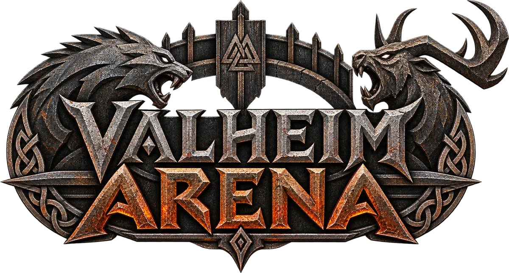
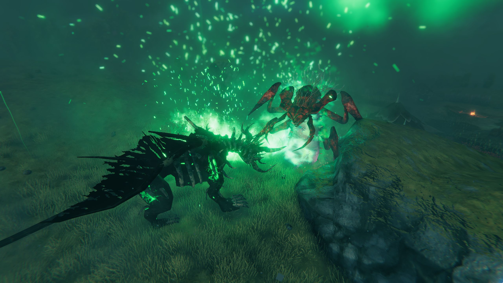
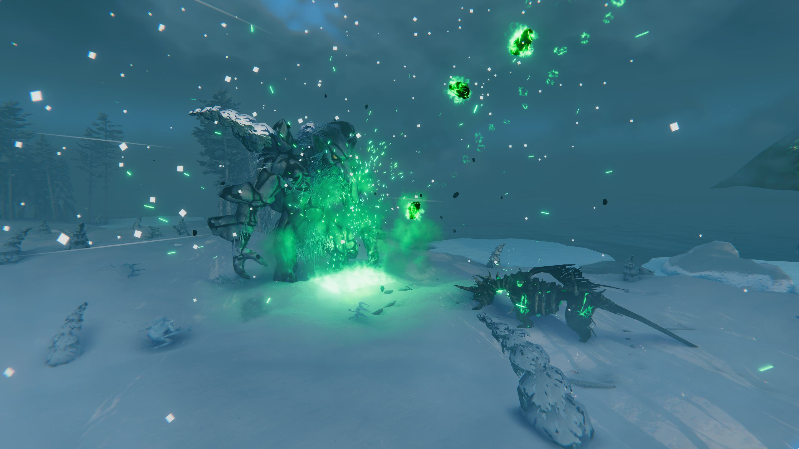
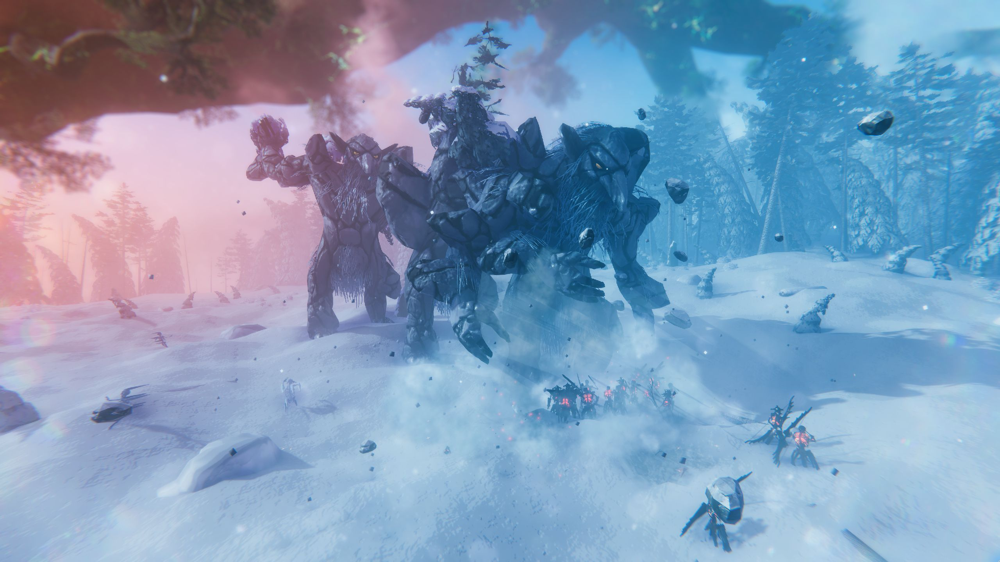
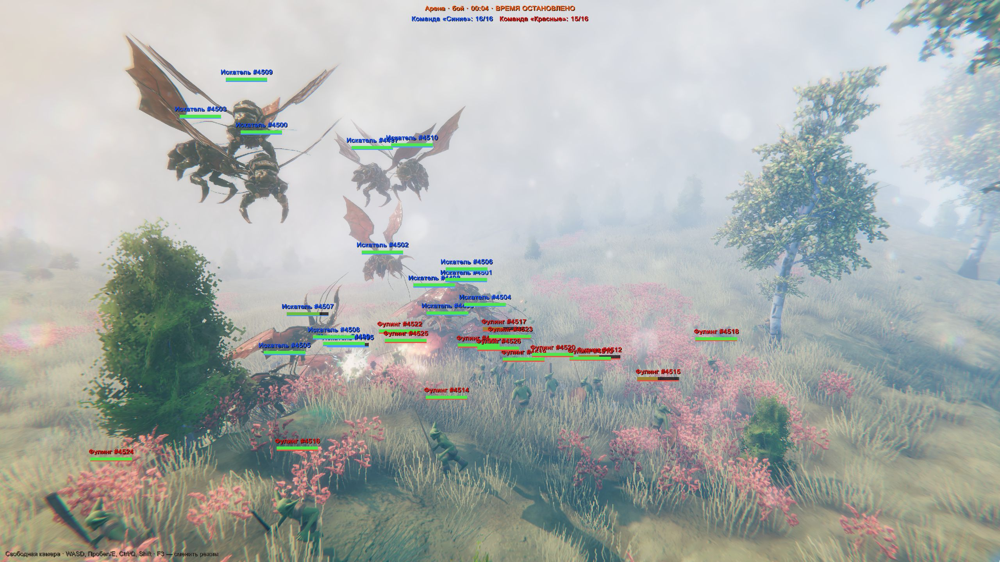
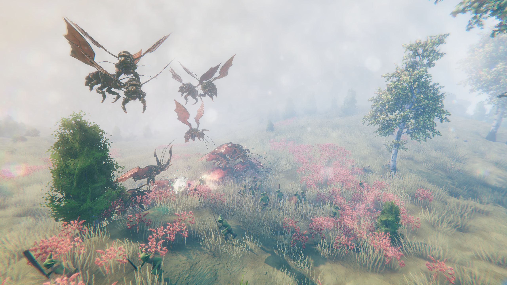

<p align="center">
  
</p>

Valheim Arena позволяет выпускать на ограниченную площадку любых существ игры с заданными звёздами, сторонами
и фракциями, наблюдать за боем свободной камерой или камерой слежения и перенастраивать в отдельном редакторе
каждое существо, вплоть до здоровья, сопротивлений и параметров каждой отдельной атаки. Мод написан для BepInEx 5.

Интерфейс доступен на английском, используемом по умолчанию, и на русском; язык переключается кнопками
EN / RU / Авто в заголовке меню арены (F7) или параметром `Language` в настройках, причём вариант «Авто»
следует языку игры.

Мод рассчитан на Valheim 1.0.16 (Unity 6) и BepInExPack Valheim 5.4.2333.

<table>
  <tr>
    <td colspan="2" align="center"><br><sub>Королева против Прародителя</sub></td>
  </tr>
  <tr>
    <td width="50%" align="center"><br><sub>Гаммельтролль против Прародителя</sub></td>
    <td width="50%" align="center"><br><sub>Гаммельтролли против обугленных воинов и лучников</sub></td>
  </tr>
  <tr>
    <td width="50%" align="center"><br><sub>Искатели против фулингов с оверлеем арены: счёт сторон, таблички и полоски здоровья</sub></td>
    <td width="50%" align="center"><br><sub>Тот же момент со скрытым оверлеем (F10)</sub></td>
  </tr>
</table>

## Установка

- Через менеджер модов мод устанавливается как ValheimArena с Thunderstore (r2modman, Thunderstore Mod Manager),
  и BepInExPack Valheim при этом ставится автоматически.
- Для ручной установки требуется BepInExPack Valheim (https://thunderstore.io/c/valheim/p/denikson/BepInExPack_Valheim/); архив `ValheimArena-<версия>.zip`
  из раздела Releases распаковывается в папку игры так, чтобы получился путь
  `Valheim\BepInEx\plugins\ValheimArena\ValheimArena.dll`.
- Сборка из исходников описана в разделе [«Сборка»](#сборка).

Всем игрокам, которые участвуют в бою или находятся рядом с ареной, нужна одна и та же версия мода, и его
желательно поставить также на сервер мира (см. раздел [«Зона симуляции»](#зона-симуляции)). После запуска
в `BepInEx\LogOutput.log` появляется строка `Valheim Arena <версия> loaded: N patches, 0 errors`, а при
русском интерфейсе `… загружен: патчей N, ошибок 0`.

Настройки и данные хранятся в `BepInEx\config\`:
- в `valheimarena.arena.cfg` записаны язык интерфейса (`Language`: English по умолчанию, Russian или Auto, следующий языку
  игры), клавиши, масштаб интерфейса в виде множителя к автоматическому (окна подстраиваются под высоту экрана,
  и при 1080p множитель равен 1) и чувствительность мыши;
- в `ValheimArena\settings.json` записаны все настройки арены и состав; файл сохраняется при закрытии окна;
- в `ValheimArena\profiles\<прототип>\<имя>.json` лежат профили существ из редактора;
- в `ValheimArena\scenarios\<имя>.json` лежат сохранённые сценарии, то есть состав и правила арены.

## Клавиши

Назначения клавиш меняются в разделе `Keys` файла cfg.

| Клавиша | Действие |
|---|---|
| F7 | Меню арены |
| F8 | Редактор существ |
| F3 | Смена камеры: игрок, свободная, слежение |
| F6 | Развернуть арену, если она не развёрнута; иначе начать бой, поставить его на паузу или продолжить |
| `[` `]` | Предыдущий и следующий боец в слежении (при развёрнутой арене) |
| `-` `=` | Замедлить и ускорить время в пределах от остановки до ×3 (при развёрнутой арене и без других игроков в мире) |
| F4 | Показать или скрыть таблички над бойцами с именем, звёздами и полоской здоровья |
| F10 | Показать или скрыть весь оверлей арены: таблички, счёт сторон и ленту убийств |
| F1 | Показать или скрыть интерфейс самой игры: HUD, миникарту, полоски над существами, сообщения игры, чат и подсказки клавиш; оверлей и окна арены остаются |

Свободная камера перемещается клавишами WASD, поднимается клавишами Пробел и E и опускается клавишами Ctrl и Q;
Shift ускоряет её втрое, Alt замедляет до ×0,3, а колесо мыши задаёт скорость. В режиме слежения мышь вращает
камеру вокруг цели, а колесо меняет дистанцию. При открытом меню обзор доступен только с зажатой правой кнопкой
мыши.

## Меню арены (F7)

### Арена

Арена разворачивается вокруг точки включения, которой служит персонаж или точка прицела камеры, и её центр
впоследствии можно перенести. Граница задаётся радиусом или полушириной от 5 до 150 м и имеет форму круга или
квадрата; выход за неё либо свободен, либо останавливается стеной, в которую бойцы упираются, либо приводит
к возврату в центр. На местности граница отображается кольцом со столбами, повторяющим рельеф. Для летающих
существ задаются потолок и высота полёта, причём нулевая высота означает, что её определяют само существо и его
атаки; по желанию граница удерживает и персонажа. Ход боя настраивается отсчётом перед стартом, ожиданием
команды, автостартом и заморозкой выживших после итога.

Поведение в бою задаётся для всей арены и может быть переопределено для отдельной группы:
- в режиме «Идёт к врагам» боец во время боя всегда знает положение врагов на арене, в том числе за
  препятствиями и в тумане, и движется к ним, а поводок боссов снимается;
- в режиме «Стоит на месте» боец не сходит с места, разворачивается к врагу и атакует, когда тот входит
  в дистанцию атаки, так что стрелки стреляют издали;
- в режиме «Свободно» боец ведёт себя как в игре: видит собственными глазами, без цели бродит у места
  появления, а боссы держатся этого места как алтаря благодаря точке патруля и игровому поводку преследования.

Посторонние существа внутри границы, то есть забредшие дикие и чужие призывы, по выбору не замечаются,
вовлекаются в бой командой «Посторонние», враждебной всем командам, или убираются. Существа, призванные
бойцами (слуги боссов, порождения атак, снарядов и эффектов, а также порождения при гибели бойца), всегда
встают на сторону призвавшего и получают его команду, фракцию и поведение. Боссы и существа прогресса мира,
у которых есть ключ победы, посторонними не становятся, поэтому настоящий босс, вызванный на алтаре рядом
с ареной, остаётся игровым. Лекари и поддержка лечат только союзников на арене; детёныши-бойцы не вырастают,
а приручённые бойцы не подчиняются командам зрителей и не размножаются. Дополнительные правила запрещают бойцам
убегать и ломать постройки, будят спящих при появлении, включают или отключают добычу, в том числе выпадающую
из тела, и убирают бойцов исчезнувших арен.

Очистка арены настраивается наборами «Полностью» и «Только существа» либо выбором «убрать» или «оставить» для
каждой категории: существ (бойцов и трупов), ресурсов (предметов на земле), надгробий игроков вместе с вещами,
окаменевших гаммельтроллей (каменных статуй павших гаммельтроллей, служащих золотыми жилами, и их осколков)
и упавших деревьев. Бойцы арены убираются, где бы они ни находились, включая замороженных вне зоны симуляции;
всё остальное убирается только внутри границы, а дикие существа, постройки, пни и растущие деревья
не затрагиваются. Настройка действует на кнопку «Очистить арену» и на сворачивание арены, при котором существа
убираются всегда. Гость может убрать надгробия лишь в том случае, если хозяин сам отметил их как «убрать».

Ход времени управляется кнопками «стоп» и ×0,1…×2, а клавиша `=` ускоряет его до ×3; управление доступно
только в одиночной игре или в собственном мире, пока к нему никто не подключён. На этой же вкладке состав
и правила арены сохраняются в сценарии.

### Бойцы

Каталог включает всех существ игры и модов и поддерживает поиск и фильтры по признакам самой игры: боссов,
летающих (всегда или взлетающих самостоятельно), водных (не выходящих на сушу), а также фракции, по которым
игра определяет, кто кому враг (животные, лесные, нежить, горные, равнинные, туманные, двергры и другие).
Для выбранного существа показывается, как его выпускает сама игра: биомы, размер стаи, звёзды, время суток,
набеги, логова и алтарь; кнопка «Как в игре» переносит в группу ванильные размер стаи и звёзды.

Группа задаётся количеством (от 1 до 200), диапазоном звёзд (от 0 до 20, где уровень равен числу звёзд плюс
один; облик игра меняет только до 2★, тогда как здоровье и урон растут и дальше), командой (от 1 до 8), фракцией
(как у прототипа или любой другой), профилем из редактора, размещением (сторона команды, случайно по арене,
центр или прицел камеры), разбросом и поведением (как у арены, «Идёт к врагам», «Стоит на месте» или
«Свободно»). Состав представляет собой список групп, которые выпускаются по одной или всем составом, правятся
и переупорядочиваются.

### Столкновения

Враждебность определяется одним из трёх режимов. В режиме «Команды» матрица 8×8 задаёт, какие команды враждуют
(по умолчанию враждуют все разные команды), а персонажа можно записать в команду. В режиме «Фракции» направленная
матрица фракция×фракция определяет, кто на кого нападает; изначально она соответствует игре, а кнопки «Боссы
атакуют рядовых» (с флажком «и рядовые отвечают»), «Все фракции враждуют» и «…и внутри фракций тоже» заполняют
её типовыми вариантами. В режиме «Все против всех» каждый враждует с каждым.

Общие правила включают дружественный огонь; удары по площади по врагам того же вида, без которых бой «тролль
против тролля» невозможен, поскольку в игре AoE не задевает одноимённых существ; изоляцию арены от диких существ
и других игроков; независимость урона от числа игроков рядом. Последнее правило существенно потому, что в игре
каждый дополнительный игрок в радиусе 100 м усиливает удары существ на 4 % и их живучесть на 30 %, в том числе
в бою существ между собой, тогда как на арене по умолчанию урон соответствует одиночной игре. Посторонние между
собой враждуют в точности как в игре, то есть по правилам общей группы, приручения и агрессии.

### Камера

Вкладка задаёт режим камеры, скорость, поле зрения и ограничение полёта, необходимое потому, что мир
прогружается вокруг персонажа. Слежение работает в стилях «Орбита», «Погоня» и «Сверху» с настраиваемой
дистанцией, автоматическим переключением при гибели цели и «режиссёром», который сам переводит камеру на тех,
кто дерётся. Список бойцов показывает их здоровье, а щелчок по строке включает слежение за бойцом. Здесь же
настраивается оверлей: таблички над бойцами с именем, звёздами и полоской здоровья (их быстро скрывает
клавиша F4), полоски здоровья, лента убийств и дальность табличек, а флажок «Скрыть интерфейс игры» (клавиша F1)
убирает с экрана интерфейс самой игры, оставляя оверлей и окна арены.

### Персонаж

Настройки персонажа действуют во всём мире, а не только у арены, и сохраняются между сеансами.
- При выключенном «Видимом отображении» персонаж и снаряжение не отрисовываются у всех игроков с модом, однако
  существа его по-прежнему видят.
- «Столкновения тела» бывают обычными, «Сквозь существ» или отключёнными. В режиме «Сквозь существ» тела,
  удары, снаряды и площадные атаки существ проходят сквозь персонажа, существа не выбирают его целью, а его
  оружие не задевает существ; при отключённых столкновениях к этому добавляется выключенная физика персонажа,
  который замирает на месте, что удобно при свободной камере.
- Если флажок «Существа реагируют на персонажа» снят, персонажа никто не замечает, а удары, площадные атаки
  и шальные снаряды существ его не задевают, хотя тело остаётся твёрдым; его оружие, в свою очередь,
  не задевает существ.
- «Неуязвимость» исключает любой урон, ошеломление и отбрасывание из любого источника, включая горение, яд
  и дым, причём существа по-прежнему замечают персонажа и атакуют его как обычно.
- Предустановки «Наблюдатель» и «Участник» выставляют эти параметры набором.

### Итоги

Итоги показывают результат боя, стороны с числом живых и всех бойцов, убийствами и уроном, живых бойцов,
а также павших с указанием времени жизни, нанесённого урона, убийств и убийцы.

## Редактор существ (F8)

Работа в редакторе строится по схеме «выбор существа, правка, сохранение под именем»; изменённые значения
подсвечиваются, а рядом с ними выводится ванильное значение.

Раздел «Живучесть» задаёт базовое здоровье с расчётом по звёздам и уровню мира NG+, размер, множители
наносимого и получаемого урона, которые действуют на весь урон (оружие, снаряды, AoE, эффекты, горение и яд),
порог ошеломления и восстановление здоровья.

Раздел «Сопротивления» содержит 11 типов, а именно 10 обычных и особый NonPlayer (сопротивления не учитывают
«чистый» урон), со шкалой от «очень уязвим ×2» до иммунитета и игнора; отдельно задаются сопротивления каждого
слабого места, по которым игра считает попадание в него.

Раздел «Движение» охватывает шаг, скорость, бег, повороты, ускорение, прыжок, полёт с поворотом в полёте
и плавание, а раздел «Поведение ИИ» задаёт зрение, угол обзора, слух, видение сквозь туман, дальность тревоги,
паузы между атаками, кружение и бегство.

Раздел «Атаки» перечисляет каждую атаку отдельно; у гуманоидов Valheim атакой служит предмет-оружие. Для
каждой атаки задаются включение, урон по 12 типам, отбрасывание, удар в спину, возможность блока и уворота,
дальность и минимальная дистанция применения, перезарядка, угол, приоритет, окно по доле здоровья, шанс
эффекта атаки (горения, яда и прочих), условия «только в тумане» и «только в подземелье», множители урона,
отбрасывания и ошеломления, зона поражения в зависимости от типа атаки (дальность и сектор удара, радиус
и центр площади или точка вылета снаряда) и параметры снарядов, то есть их скорость, количество и очереди.
Отдельно редактируются эффекты с собственным уроном: удары по площади, взрывы, лужи, осколки и порождения
способностей. Пометки у атаки показывают её назначение (враг, лечение или поддержка союзников) и условия
срабатывания. Урон атак растёт со звёздами как ×(1 + 0,5 · звёзды), тогда как собственный урон эффектов от
звёзд не зависит.

Профиль выбирается в группе состава или применяется немедленно кнопками «Применить к бойцам этого вида»,
«Применить к цели камеры» и «Вернуть им ваниль». Правки действуют только на бойцов арены: каждый боец получает
собственную копию данных атак, а прототипы и остальной мир остаются неизменными.

## Сетевая игра

Арена работает как на выделенном сервере, так и в мире, запущенном через «Запустить сервер». Мод необходим
всем игрокам, которые участвуют в бою или находятся рядом с ареной. Серверу мод для обмена сообщениями не нужен,
поскольку сервер лишь пересылает их, однако с модом на сервере бойцы не замерзают на кромке зоны симуляции
(см. раздел «Зона симуляции»). Версии мода у игроков должны совпадать, а при расхождении мод сообщает, что
протокол отличается.

- Хозяином арены считается игрок, который её развернул. Он задаёт границы и правила, ведёт ход боя и итоги,
  а остальные игроки с модом получают всё это: видят границу, оверлей, отсчёт, ленту убийств и итоги и могут
  следить камерой за бойцами.
- Гостем считается любой игрок рядом с чужой ареной, на расстоянии до 200 м от её границы. Правила хозяина
  доступны гостю только для просмотра. Если хозяин разрешил это флажком «Гости могут управлять боем
  и выпускать бойцов», включённым по умолчанию, гость начинает бой, ставит его на паузу и очищает, а также
  выпускает своих бойцов из собственного состава и со своими профилями.
- Каждый игрок сам определяет, видим ли он, реагируют ли на него существа, в какой он команде и неуязвим ли,
  и эти настройки видны всем клиентам. Игрок за границей изолированной арены остаётся зрителем, которого бойцы
  не трогают, а невидимого игрока прячут у себя все клиенты с модом.
- Существом в Valheim управляет клиент-владелец, и сервер передаёт владение ближайшему игроку, если прежний
  владелец далеко. По этой причине правила арены (ожидание старта, граница, поиск цели, дружественный огонь)
  применяет у себя любой клиент с модом к тем бойцам, которыми владеет в текущий момент.
- Бойцы помечены своей ареной, поэтому клиент убирает только бойцов собственной прошлой арены или арены,
  о которой нет вестей дольше 30 с (например, после выхода хозяина); бойцов живой чужой арены никто не удаляет.
- Хозяину следует находиться у арены, поскольку итог боя он считает по бойцам, которых видит, а игра обновляет
  существ только вокруг игроков; меню предупреждает, если граница выходит за эту зону.
- Замедление и остановка времени доступны только в одиночной игре или в собственном мире, пока к нему никто
  не подключён, и никогда на выделенном сервере; это ограничение самой игры.
- Прав администратора мод не проверяет: на сервере любой игрок с модом может выпускать существ, включая боссов,
  и включать себе невидимость и неуязвимость, поэтому мод уместен там, где все игроки на это согласны.

### Зона симуляции

Игра обновляет существ только в активной зоне вокруг игроков, которая в зависимости от положения персонажа
простирается от него на 64–128 м. Боец арены, вышедший из активных зон всех игроков, остаётся без владельца:
игра замораживает его, хотя он жив, и бой с его участием не заканчивается.

Мод на сервере мира сохраняет владение бойцами арены, пока они находятся рядом с владельцем, а бойцов,
оставшихся без владельца (например, после выхода владельца из игры), передаёт игроку, рядом с которым они
находятся; замороженный боец помечается «(заморожен)». Без мода на выделенном сервере это поведение остаётся
игровым, поэтому мод следует поставить и на сервер, скопировав `ValheimArena.dll` в `BepInEx\plugins` сервера
вручную (менеджеры модов сервер не обновляют), либо держать арену радиусом не более ~60 м вокруг персонажа
хозяина.

## Как это устроено

- Враждебность определяется патчем `BaseAI.IsEnemy`: для бойцов арены её решают команды, фракции и режим
  столкновений, а для персонажа флаг «Существа реагируют на персонажа». На эту функцию опираются поиск цели,
  удары, снаряды и AoE игры.
- Ожидание старта и пауза реализованы патчем `MonsterAI/AnimalAI.UpdateAI`.
- Режим «Идёт к врагам» опирается на патч восприятия `BaseAI.CanSenseTarget/CanSeeTarget/CanHearTarget`,
  благодаря которому цель внутри арены во время боя всегда «видна», и на назначение ближайшего врага. Режим
  «Стоит на месте» реализован патчем `BaseAI.MoveTowards(/Swoop)`, разворачивающим бойца без шага, а режим
  «Свободно» использует точку патруля и поводок `m_maxChaseDistance`, как у босса у алтаря.
- В режиме «Идёт к врагам» точка движения летуна (`BaseAI.MoveTo`) поднимается: подлёт идёт на крейсерской
  высоте, а у цели летун занимает высоту, с которой достаёт текущая атака, с учётом трёхмерной дальности и окна
  `m_aiWhenFlyingAltitudeMin/Max`. Летун, зависший в радиусе атаки, добирает нужную высоту; существа, летающие
  по прототипу, но севшие дольше чем на 4 с, взлетают, а в режиме «Стоит на месте» летун висит на крейсерской
  высоте.
- Призывы обрабатываются через контекст создателя вокруг `Attack.OnAttackTrigger/FireProjectileBurst/SpawnOnHitTerrain`,
  `Projectile.SpawnOnHit`, `SE_Spawn`, `SpawnOnDamaged` и `SpawnAbility.SetupAoe` (призыв боссов, выполняемый
  в сопрограмме): существо, созданное внутри этого контекста, получает арену и команду создателя.
- Окна рисуются средствами IMGUI, а мышь и клавиатура читаются из Input System так же, как это делает сама
  игра (`UI\UiInput.cs`); щелчок привязывается к элементу при отрисовке и срабатывает в начале следующего кадра.
- Камера подменяет `GameCamera.LateUpdate`; для игры это состояние свободного полёта, поэтому персонаж
  не принимает ввод, хотбар скрыт, а трава и детали рассчитываются от камеры.
- Бойцы помечаются в ZDO ключами `va_*`, в которых хранятся команда, фракция, профиль в JSON, арена, хозяин
  и создатель. Смену профиля чужого бойца выполняет его владелец по RPC на объекте, а остальные клиенты
  подхватывают профиль из ZDO.
- Сеть построена в `Core\ArenaNet.cs` поверх `ZRoutedRpc` игры: хозяин рассылает всем состояние и правила при
  изменении и раз в 3 с, гости отправляют хозяину команды, владелец пострадавшего раз в секунду сообщает хозяину
  урон, владелец погибшего сообщает всем о гибели, а хозяин рассылает сводку итогов. Настройки игрока хранятся
  в ZDO его персонажа.
- Боссы на арене не продвигают прогресс мира, поскольку ключ победы и катсцена у бойцов отключены. Добыча
  выпадает по настройке, и если она включена, трофей босса можно положить на камень, что уже засчитывается миру.

## Ограничения

- Игрок без мода, к которому перешло владение бойцом (например, когда хозяин ушёл далеко), ведёт его как
  обычное существо; если такой игрок окажется владельцем босса в момент гибели, миру может засчитаться победа.
- Время замедляется только при отсутствии подключённых игроков.
- Мир прогружается вокруг персонажа, а не камеры, поэтому дальше ~80 м за границей свободная камера видит
  пустоту; ограничение «Не улетать дальше 80 м за границу» можно снять.
- Бойцы выше 2★ сохраняют облик 2★, поскольку других обликов по звёздам у существ игры нет.
- Перед удалением мода арену следует свернуть во всех мирах, где она развёрнута: бойцы хранятся в мире и без
  мода остались бы обычными существами, в том числе боссы.
- Если обновление игры переименует метод, лог BepInEx укажет, какой патч перестал
  применяться, а остальные функции продолжат работать.

## Сборка

Для сборки нужны .NET SDK 8 или новее и установленная Valheim с BepInExPack Valheim в папке игры: сборки игры
и BepInEx берутся оттуда и в репозиторий не входят. Сам мод нацелен на netstandard2.1, а .NET 8 требуется
только проверке PatchCheck.

```
.\build.ps1                                 # Release и сверка Harmony-патчей с установленной игрой
.\build.ps1 -Deploy                         # то же и установка в BepInEx\plugins\ValheimArena
.\build.ps1 -ValheimDir "D:\Games\Valheim"  # игра в другой папке
.\build.ps1 -SkipVerify                     # сборка без сверки патчей
```

Если PowerShell отказывается запускать скрипт, его запускают командой
`powershell -ExecutionPolicy Bypass -File .\build.ps1`.

`tools\PatchCheck` сверяет с установленной версией Valheim цели всех Harmony-патчей, а также закрытые методы
и поля игры, к которым обращается мод, и после обновления игры показывает, что именно разошлось.
